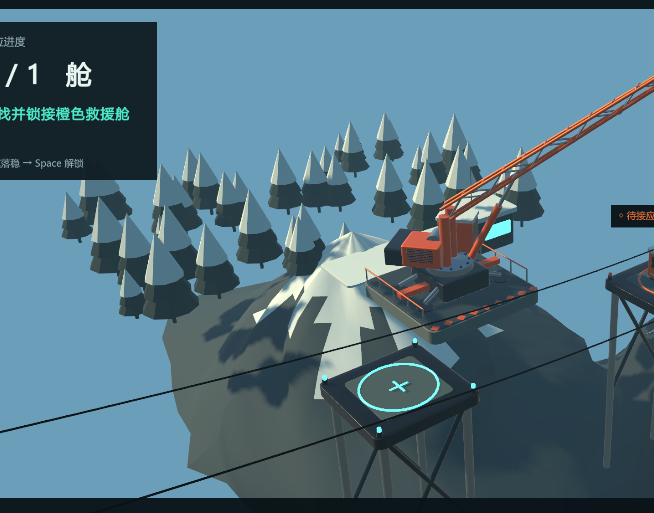
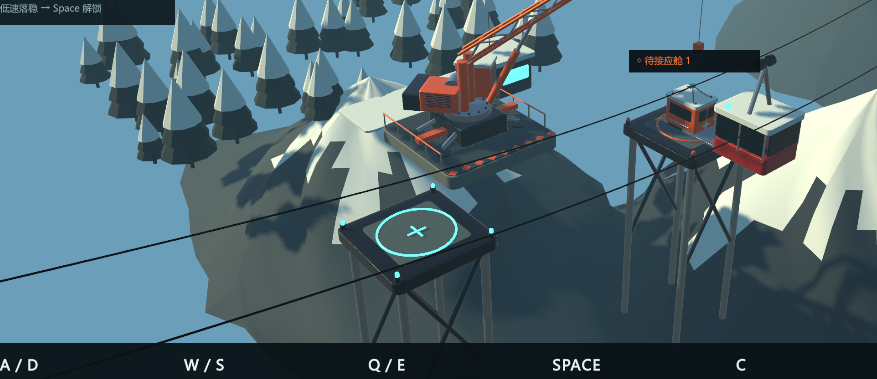
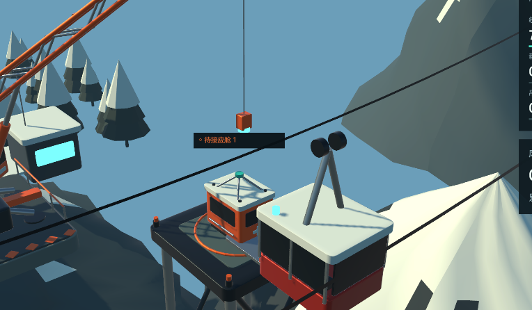
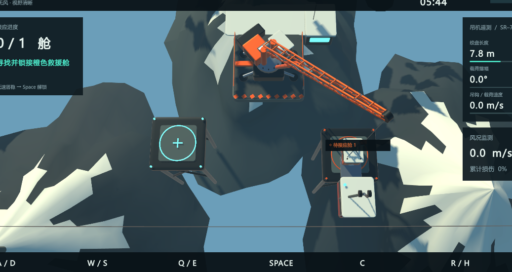
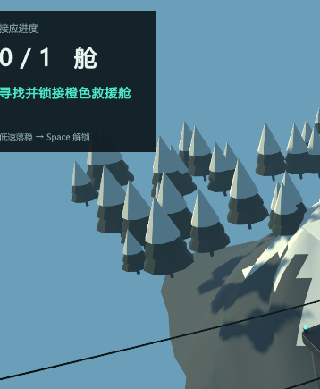

# U1 霜岭索道救援画面改造前基线

记录日期：2026-11-06，Asia/Shanghai；核验时间约 17:17。阶段：改造前资料核验与截图观察。记录模型：gpt-6-astra，OpenAI Codex。本阶段仅新增本文件，没有修改代码、场景、材质、预制体或项目配置，没有构建、重新打包或启动游戏。

本次项目为既有 **U1_Unity_霜岭索道救援**，沿用 U1 标识与原项目目录，不重新编号。关联既有会话 **01a1af64-934e-7b72-8594-5af7bf39863b**，对应上一轮固定源码及 Windows 归档如下。

## 入口规范读取情况

已完整读取工作区根目录 `E:/Sale Gpt6/游戏采购开工包_20261105/AGENTS.md`，并检查其指定路径：

`E:/Sale Gpt6/游戏采购开工包_20261105/精品项目提示词/00_通用执行规范.txt`

该文件仍不存在。对 `E:/Sale Gpt6` 检索同名规范未找到，因此**不能声明已经读取通用规范**。项目目录内未检出额外 AGENTS.md。已读取既有开工核验、验证报告和 Delivery/manifest.jsonl 以核对上下文。

此前用户在同一会话已授权“按现有 U1 要求先行开发，缺项标待补”。本次按用户最新要求，仅进行基线记录；规范缺失继续如实标待补，不擅自补写或替代正式规范。本文件不代表已获得下一阶段代码改造的范围确认，也不代表采购验收通过。

## 关联归档与当前工作区

项目绝对路径：`E:/Sale Gpt6/游戏采购开工包_20261105/U1_Unity_霜岭索道救援`。此前聊天末尾误写的 `C:/Users/admin/游戏采购开工包_20261105/...` 交付链接不是本次核实的项目位置，后续以此 E 盘路径为准。

| 版本对象 | 路径 | 本次重新计算的 SHA-256 |
| --- | --- | --- |
| 既有固定源码归档 | Delivery/U1_FrostlineRescue_Source.zip | 8A0B9E518649EEDA44389BE74440686FC21CADA9B7CDF72DF10670EEB1427016 |
| 既有 Windows 归档 | Delivery/U1_FrostlineRescue_Windows.zip | 448D22547F4A9EEFA212AEA6B2AF4E4F1BCCED5D8A73CD4BECB36D10BD86B91A |

两项哈希均与 Delivery/manifest.jsonl 一致。交付记录注明 Unity 6000.6.7f1、Windows x64；既有验证报告注明 URP 17.6.0。本次不重跑或改写既有测试结论。

只读比较源码归档中 Assets、Packages、ProjectSettings 及 Build/Run/Package 脚本对应的 100 个文件，97 个相同，3 个配置文件不同。差异在本次任何写入前已存在，未判断修改者或产生原因，未回滚：

| 当前工作区文件 | 相对归档的已观察差异 | 当前文件 SHA-256 |
| --- | --- | --- |
| ProjectSettings/GraphicsSettings.asset | m_LightsUseLinearIntensity、m_LightsUseColorTemperature 从 0 变为 1 | FB0E7DB1392497E9C7B352E65927F21A3F78F2BCAF607CFBBC8D837B6C405A05 |
| ProjectSettings/InputManager.asset | 新增调试相关输入条目，已观察到 Enable Debug Button 1、Enable Debug Button 2、Debug Reset；此处不将摘录视为完整差异列表 | 7AE5CE92FCAC97CC0F3188C52D38CF5CBCE5FB90D12365D2A7E7EDA600571C6D |
| ProjectSettings/QualitySettings.asset | 观察到 antiAliasing 从 2 变为 4 | 6A497FDAFD864A1489BA1839074E3AA84EC0D9E33B0A3F8F8881BF8D3CE52D3C |

因此当前工作区不能直接标为与固定源码归档完全相同。本比较限于归档中的对应文件，不是对所有新增文件的全量盘点。截图未附运行版本、编辑器/独立包来源和拍摄参数，无法证明来自这份 Windows 归档或上述当前配置；本基线将“归档身份”“当前工作区差异”和“用户提供截图”分别记录。

## 截图证据清单

已逐张打开并直接观察 `shots` 中全部 5 张 PNG，未使用文件名推测画面内容。以下顺序按文件修改时间排列；修改时间不是已核验的拍摄时间。各图尺寸不同，部分 HUD 位于图像边缘之外，可能为裁切或局部截屏，不能据此确定完整游戏窗口的布局。

| 标记 | 文件 | 像素尺寸 | 文件修改时间 |
| --- | --- | --- | --- |
| S1 | 8e54dce2d1e147c89a99c80b76c5f457.png | 654 × 513 | 17:07:47 |
| S2 | a5f1e05dbcf513653cf30bf332cb4a56.png | 877 × 379 | 17:08:15 |
| S3 | ebd68a3c506f411c34b4a9335b1852d3.png | 764 × 446 | 17:08:35 |
| S4 | 17e57bbc93963a34ca5b8ef6f325d7be.png | 1037 × 551 | 17:08:53 |
| S5 | 61400b4449ea0ece57a83b8229b10ca6.png | 358 × 435 | 17:09:16 |

截图 SHA-256：

```text
S1 71C4DB5D97E0EAECB8E25B8F211083138BCDA3521DC28FB9B25CDD292BAB99D7
S2 FD2A630BB307F8BC20738BDAC3977BDD0D163325EE4BB77013417AA6260979FA
S3 28F8794642EB135AA0AC9BCC949C00842C38A01406B8B47138D4B13D80B14248
S4 796A6F2F6D7801B7670B758F272EA72A931E9E2AAE7BF7FF2AF06909830AF56A
S5 D18342815E6B09C31183B2FA31D17580CA55AC372FDBE260B6A6D5E0863EA868
```

### S1 吊机平台与松林斜视



中央偏右可见橙色桁架吊臂、深色底座、驾驶室及设备平台，吊臂延伸到右上图像边界之外。平台边缘有橙黑警示条和细栏杆；前下方另有青色圆环与十字标记的接应台。左后方是一片重复三角锥分层构成的雪松，地面及树下有清楚投影。山体由较大的灰绿色折面组成，白色积雪沿尖锐折面分布。背景与山体外部为大片平坦蓝色。两条深色索道线横穿前景。左上 HUD 显示接应进度与任务文字，但左侧文字和数字部分被图像边缘截断。

观察判断：吊机的机械身份、橙色安全涂装和青色目标区已经可辨；树木形态重复、岩体大折面和大面积无细节背景使场景呈现明显低多边形示意风格。设备表面颜色较均匀，图中未能辨认足以体现真实尺度的磨损、粗糙度或表面纹理变化。

### S2 吊机、接应台与故障缆车的空间关系



吊机处于上方中央，青色接应台在前方偏左；右侧高脚钢架平台上有橙色救援舱，旁边是红黑车身、白色顶盖的较大缆车。救援舱上方显示“待接应舱 1”。两条黑色索道线横穿作业区，较大一条贯穿画面中部。底部可见深色按键栏中的 A/D、W/S、Q/E、SPACE、C。山体大块阴影与白色雪面反差强，平台支腿清楚可见，但谷底、远景和支腿的最终落脚点没有在此图中充分交代。

观察判断：吊机—取舱平台—接应台的关系比 S1 清楚，橙色与青色具有实用的任务识别价值；空间连接、平台落地支承及山谷纵深的可信度仍弱。索道线在此视角对主体产生视觉切割，是否在所有可操作视角都影响操作需运行观察。

### S3 吊钩、救援舱与缆车近景



中央上方是垂直钢缆和橙色小型吊钩块，底部有青色部件；下方“待接应舱 1”标签盖在背景与索道线附近。橙色救援舱可见浅色顶盖、顶部吊索/吊环和暗色窗面。右前方较大缆车可见浅色倒角顶盖、红色下车身、黑色窗面、双支杆及两个黑色圆轮。左侧驾驶室窗呈非常明亮的青色块。近景岩壁仍是大面积纯色折面，右下雪面很亮。右侧遥测面板只露出一部分。

观察判断：现有核心资产已具有顶盖、窗框、吊索、桁架或轮组等分件，不能描述为完全没有细节；但窗面偏纯黑/纯亮色，材质、接缝和机械连接的细节层次仍不足以呈现精细写实设备。该图能确认吊钩悬在救援舱上方，不能证明锁接已经成功、碰撞准确或摆动自然。

### S4 俯视作业全局



俯视下中央偏上是吊机底座，橙色吊臂向右下伸出；左下为青色接应圆环平台，右下为橙色取舱平台、救援舱与缆车。三个主要平台之间的水平关系较易理解。屏幕可见计时 05:44、接应进度 0/1、绞盘长度 7.8 m、摆幅 0.0°、速度 0.0 m/s、风速 0.0 m/s 与损伤 0%。底部有 A/D、W/S、Q/E、SPACE、C、R/H 操作栏。深色 HUD 占据左右边缘与底部，图像左侧及上方有截断。

观察判断：任务状态和控制分组已建立；俯视图有助于理解目标位置，但需要结合侧视或高度信息才能判断实际高度和落舱支承。近处岩体占画面较大比例，蓝色空隙和大块深色阴影仍明显。静止值只能代表这一帧显示的数字，不能用作帧率、计时、物理或输入正确性的证明。

### S5 松林与岩壁局部



图像主要是左侧 HUD、重复锥体树冠的雪松群、带白雪的折面岩壁和蓝色背景，右下仅露出接应平台一角，一条黑色索道线斜穿下部。主吊机和救援舱不在可见范围内。

观察判断：这张局部图最清楚地显示了植被重复、轮廓简单与地形纹理层次不足的问题。由于图片宽度仅 358 像素、内容明显局部，不能把“主目标不在图中”直接判定为相机跟随失效或完整游戏构图错误。

## 综合画面基线与后续对照重点

当前可见画面具有一致的冷蓝背景、灰绿岩体、白雪、橙色设备、青色交互标识及深色 HUD。机械和目标区可辨，有投影、分件与三维空间关系；但整体更接近低多边形程序化演示效果，**仅凭这五张截图，尚不能认为达到了 U1 精细写实核心资产与精品画面的要求**。

以下仅记录待改造重点及未来对照方式，不在本阶段实施：

| 维度 | 当前可见问题或有效基础 | 后续应以同类视角核对的内容 |
| --- | --- | --- |
| 核心机械资产 | 橙色涂装与桁架明确；驾驶室、缆车和舱体表面较均匀，连接部件读数偏弱 | 相同距离下倒角、接缝、吊挂连接、玻璃与金属/涂漆的区别是否清楚，功能结构是否可信 |
| 山体与积雪 | 大片平面、尖锐白色雪块、岩面纹理少 | 岩体尺度、雪层过渡、接触关系和表面变化是否自然，是否保留目标可读性 |
| 植被 | 重复分层锥体树，轮廓与雪帽相似 | 树形、枝叶与积雪分布的变化，近中远景密度和比例 |
| 场景纵深 | 大面积蓝色空背景，谷底/远山与平台支承信息不足 | 谷底、远景层次、雾与实际空间关系，避免用浓雾遮掩操作目标 |
| 光照与材质 | 投影可见；深色面与亮雪反差较强，窗面偏黑或亮青色块 | 阴影层次、间接光、接触阴影和材质反射，保留钢缆与吊环辨识度 |
| 相机与操作阅读 | 斜视能识别设备，俯视能识别平面位置；索道线穿过主体 | 正常窗口内全部任务目标、吊钩与落区是否可读；高度、遮挡与视角切换需运行确认 |
| HUD | 色彩语义、任务、仪表、键位分组已建立；截图边缘存在截断 | 用完整窗口原图检查安全边距、文字大小、遮挡与宽高比适配，暂不把截图裁切当作布局 bug |

## 验证边界与本阶段结果

本次以用户给出的五张实际图片作为视觉证据，已完成逐张人工模型观察和文件身份记录。未启动游戏：此前隐藏窗口截图为全黑，用户已要求保持后台；本次现有图片足以建立静态基线，不需要再次生成无法判断的黑图，也避免启动时写入存档或修改编辑器配置。

这些截图表明至少存在非黑屏的场景呈现，修正了此前只能获得后台黑图的观察缺口；它们不证明任意设备或每次启动都能正常显示，也不证明整份归档的画面质量已经验收。

本次不能由静态图片确认：键鼠手感、钢缆与载荷运动连续性、动画时序、碰撞/锁接判定、菜单导航、完整窗口 UI、自适应分辨率、实际帧率、长时间稳定性，以及四关全部画面。既有 23 项规则与 28 项运行断言来自上一轮验证，未在本阶段复跑，不据此宣布画面达标。

本阶段写入仅为 `Documentation/画面基线.md`；代码、工程配置、原始 shots 和两份固定归档均未由本次操作修改。此记录尚不包含在旧源码压缩包中，旧归档哈希继续保留作为改造前版本锚点。
